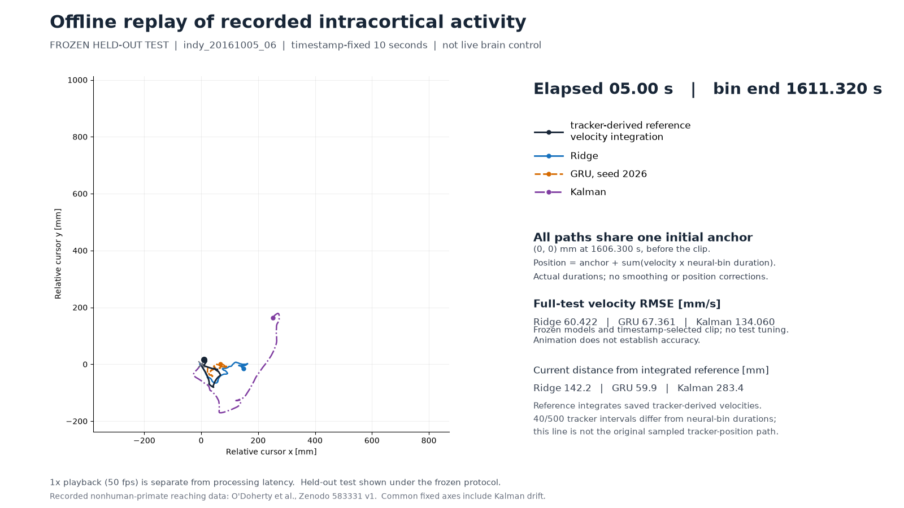

<a id="top"></a>


# NeuroDecode

Predict **2D hand/cursor velocity from recorded invasive neural spike activity** during a monkey reaching task. Compare zero velocity, training mean, ridge regression, a Kalman filter and a small causal GRU on the same chronological scoring rows.

This is an independent educational project using public data. The completed experiment is **offline decoding and replay**, with no live brain control.

[Results](#held-out-results) · [Setup](#setup-and-checks) · [Reproduction](#reproduce-or-review-the-results) · [Demo](#fixed-interval-demo) · [Interview notes](docs/interview_notes.md)

## What the recording contains

In the original experiment, a monkey moved its hand while **intracortical electrodes** recorded spikes. Tracked movement determined the original cursor position; the decoder did not control that cursor. These implanted recordings are different from scalp EEG.

The selected public file, `indy_20161005_06.mat`, contains spike-event timestamps grouped by channel/unit, channel names, behavioral timestamps and x/y cursor positions. We aggregate the supplied unit slots, including residual unsorted events, into **96 ordered M1 recording channels**. Electrode IDs do not establish stable individual neurons across sessions.

Tracker-position differences divided by their actual behavioral elapsed time supply velocity labels in **mm/s**. Labels train the models and score predictions; movement values are not decoder inputs. See the [dataset card](docs/dataset.md) and [checksum manifest](data/manifest.json) for source schema, alignment caveats and acquisition.

**Source:** O'Doherty, Cardoso, Makin & Sabes (2017), *Nonhuman Primate Reaching with Multichannel Sensorimotor Cortex Electrophysiology*, [Zenodo v1, DOI 10.5281/zenodo.583331](https://doi.org/10.5281/zenodo.583331), **CC BY 4.0**. A code license has not yet been chosen.

## Causal pipeline

```text
spike timestamps -> 20 ms channel counts -> frozen training normalization
                 -> bounded history / filter state -> x/y velocity [mm/s]
                 -> common-row scoring -> optional integrated cursor replay
```

Each prediction estimates velocity for the **just-completed bin**, not future movement. Counts use `(start, end]`; history is ten consecutive bins, oldest first. Ridge flattens the normalized history; the **12,546-parameter GRU** starts each independent window with zero hidden state. Kalman uses the current normalized observation and its own previous state estimate. Histories/state reset at partition boundaries and gaps. No later reference position repairs a decoded path.

## Evaluation protocol

Time is split before constructing examples or fitting transforms, with purged boundaries. The retained intervals below are in the recording's original seconds and are half-open; exact floating-point boundaries are in the [saved split](data/splits/indy_20161005_06.json).

| Partition | Retained interval [s] | Role |
| --- | --- | --- |
| Training | [1288.0, 1549.6) | Fit count scaler, model weights and training prior/mean |
| Validation | [1550.0, 1605.7) | Select ridge regularization, GRU settings and checkpoint |
| Test | [1606.1, 1662.0) | One frozen held-out evaluation after selection |

Normalization is fitted on training bins only. The first **nine bins** supply history without a scored prediction, so all decoders start on the same eligible row. All compared models use identical targets, timestamps and exclusions within each partition. No extra Kalman settling period is removed.

The [pre-test freeze and repair amendment](docs/final_evaluation.md) fix artifacts/hashes, preprocessing, resets, metrics, exclusions and the demo interval. The test command ran once after committed-code and validation-evidence checks. Test is now opened; later test-informed changes would be exploratory. Seeds 2027/2028 remain validation-only; seed **2026** was the preselected representative GRU.

## Held-out results

**Ridge, lambda = 1000, is best by the frozen primary metric: overall velocity RMSE.** This does not imply accurate integrated position tracking.

All five models score **2,784 identical eligible test rows**, target ends **1606.320–1661.980 s**, with **100% eligible-row coverage** after nine warm-up exclusions. RMSE is **mm/s**; R² is dimensionless. Overall RMSE averages squared error across both axes and all rows; mean R² averages the two axis scores.

| Model | RMSE x | RMSE y | Overall RMSE | R² x | R² y | Mean R² |
| --- | ---: | ---: | ---: | ---: | ---: | ---: |
| Zero velocity | 80.540636 | 85.667370 | 83.143527 | -0.000027 | -0.000026 | -0.000027 |
| Training mean | 80.539999 | 85.668194 | 83.143644 | -0.000011 | -0.000046 | -0.000029 |
| **Ridge, lambda 1000** | **65.332476** | **55.074718** | **60.421673** | **0.341979** | **0.586681** | **0.464330** |
| Frozen Kalman | 99.887504 | 161.140931 | 134.059526 | -0.538169 | -2.538281 | -1.538225 |
| GRU, seed 2026 | 69.875487 | 64.748331 | 67.360708 | 0.247283 | 0.428735 | 0.338009 |

GRU beats the trivial baselines but trails ridge. Kalman performs worse than both trivial baselines; its negative R² is retained. Every model's absolute RMSE is higher than on development validation, where overall RMSE was ridge **52.571380**, GRU **54.791919** and Kalman **102.838507 mm/s**. The time blocks contain different movements, so this is not a controlled diagnosis of degradation.

The [complete final report](reports/phase7b_final.md) contains the validation comparison, full provenance, exclusions, failure history and audit. Independent exported-metric/identity checks passed. Offline/replay maximum differences were **3.410605e-13 mm/s for ridge and zero for the other models**. These numerical agreement checks establish implementation consistency, not decoding accuracy.

## Setup and checks

Python **3.11.17**, uv and the committed lockfile; CPU is sufficient. These commands work in PowerShell or a POSIX shell once [uv is installed](docs/reproduction.md#setup):

```text
git clone https://github.com/habibbumbus/neuro-decode.git
cd neuro-decode
uv python install 3.11.17
uv sync --locked --python 3.11.17
uv run --locked python -m pytest -p no:cacheprovider
uv run --locked ruff check .
uv run --locked ruff format --check .
uv lock --check
```

The **353 tests** use synthetic fixtures and require neither the recording nor saved real-data models. Missing packages/Python require network access; an empty cache cannot support `--offline`. The recorded scientific environment is Windows CPU with NumPy 2.4.6 and PyTorch 2.14.1+cpu. Exact frozen evaluation also checks the other package versions and specific FFmpeg/ffprobe builds. Setup on another OS does not promise byte-identical scientific artifacts. See the [walkthrough and platform limits](docs/reproduction.md#phase-7c-documentation-walkthrough).

## Reproduce or review the results

A fresh clone contains source, configs, split/provenance metadata, tests, reports and the small preview below. It does **not** contain the raw recording, generated arrays, `runs/`, checkpoints, full prediction logs, environments or MP4. The dataset is public; the original model/evidence bundle is **not currently published as a downloadable release**.

| Input/output outside Git | Obtain or generate |
| --- | --- |
| `data/raw/indy_20161005_06.mat` | Download the exact v1 file from [Zenodo](https://zenodo.org/records/583331/files/indy_20161005_06.mat?download=1); verify size/SHA-256 against `data/manifest.json` |
| Training scaler and fresh validation models/predictions under `runs/` | Follow the [historical validation rebuild recipe](docs/reproduction.md#rebuild-validation-artifacts); it is not an exact restoration of historical file hashes |
| Original frozen model and evidence files | Restore the original trusted project bundle at the [listed paths](docs/reproduction.md#restore-the-exact-frozen-bundle); obtain it from the project author/original checkout, not an arbitrary checkpoint download |
| Final predictions, metrics, video and verification | Restore `runs/phase7b-final-test/` to audit the saved result; the recorded frozen command is documented below for a separate archival reproduction |

### Review saved evidence without another experiment

With the original final run restored, this recomputes metrics and checks identities/hashes **from saved artifacts only**, without loading the recording or making predictions:

```text
uv run --locked python -c "import sys; from pathlib import Path; sys.path.insert(0,'scripts'); from audit_final import audit; print(audit(Path('runs/phase7b-final-test')))"
```

With the exact model/reference bundle and frozen export environment restored, preflight verifies identities without loading the recording:

```text
uv run --locked python scripts/evaluate_final.py preflight
```

The [reproduction guide](docs/reproduction.md#restore-the-exact-frozen-bundle) gives the committed-code check, fixed validation-rehearsal commands and prerequisite evidence. Missing or different hashes cause a stop; newly trained artifacts must not be substituted by changing the freeze.

<details>
<summary><strong>Recorded final-evaluation command: archival reproduction only</strong></summary>

This command has already been executed. It requires the verified raw file, exact frozen artifacts/runtime and the passing validation rehearsal. It constructs test examples and predictions. Do not rerun it in the preserved results directory or tune against its outcome. Existing outputs are deliberately protected; do not delete evidence to make the command succeed. No test experiment was run while preparing this README.

```text
uv run --locked python scripts/evaluate_final.py test --run-id phase7b-final-test --open-test-sha256 61941d4f1ed6226b2af3a80c5a79c0c88f5f374186ff5f6be047ce75094e6f28
uv run --locked python scripts/audit_final.py phase7b-final-test
```

Outputs: timestamped five-model predictions, metrics/exclusions, frozen protocol and access event, integrity/provenance, fixed figures/video/still and independent verification under `runs/phase7b-final-test/`. Exact historical model hashes and the command/output logs are recorded in the [final report](reports/phase7b_final.md).

</details>

## Fixed-interval demo



**Actual-run preview, not an illustrative reconstruction:** the predetermined middle frame of the verified **[1606.320, 1616.320) s** test clip. The video is an **offline replay of recorded intracortical activity**, with a single common initial anchor and no smoothing or later position corrections. Its reference is **tracker-derived reference velocity integration**, not the original sampled tracker-position path. Velocity errors accumulate into drift; a locally closer path does not establish lower full-block velocity error.

The full local MP4 is `runs/phase7b-final-test/cursor_replay.mp4` after restoring the evidence bundle: **500 frames, 50 fps, 10 seconds**. It is intentionally absent from Git. The [preview provenance and demo guide](docs/demo.md#held-out-preview-and-video-phase-7b7c) identifies its exact source/hash. Playback speed is separate from acquisition bin duration and measured inference processing time.

For a short presentation using the existing media, follow the [suggested 85-second interview walkthrough](docs/demo.md#suggested-85-second-interview-walkthrough). It is a narration plan, not a new export or experiment.

## Architecture and evidence map

| Path | Responsibility |
| --- | --- |
| `src/neurodecode/data/` | Recording loader, causal bins/targets, chronological split and training-only scaler/history contracts |
| `src/neurodecode/models/`, `src/neurodecode/training.py` | Baselines, ridge, Kalman, GRU and bounded training mechanics |
| `src/neurodecode/evaluation.py`, `src/neurodecode/streaming.py`, `src/neurodecode/demo.py` | Common metrics/identities, sequential replay/resets and velocity integration |
| `scripts/`, `configs/` | Runnable experiment/audit entry points and declared settings; final freeze in `configs/final_evaluation.json` |
| `tests/` | Synthetic timing, causality, leakage, persistence, replay and metric/provenance checks |
| `reports/`, `docs/` | [Final results](reports/phase7b_final.md), [replay/latency](reports/phase6a_replay.md), [simulated disruptions](reports/phase6b_robustness.md), [methods](docs/methods.md), [interview notes](docs/interview_notes.md) |

## Limitations

- **One recording and one held-out time block.** Another block from this same session is not a cross-session experiment. Channel IDs alone do not guarantee stable neural populations on another day.
- **Offline recorded-data analysis.** No online feedback, acquisition hardware or closed-loop cursor control; no human or clinical claim.
- **Velocity is not position accuracy.** Tracker-derived finite-difference labels and numerical integration have timing limitations and can accumulate substantial drift.
- **No statistical significance claim.** Overlapping histories and correlated time bins are not independent trials; GRU seed variability on validation is not cross-session uncertainty.
- **No hard real-time guarantee.** [Validation processing latency](reports/phase6a_replay.md) was measured separately; animation playback and a 20 ms acquisition bin do not prove a deadline is always met.
- **Reproducibility has a boundary.** Public source and raw data support setup/tests and independent rebuilding; exact historical evaluation also needs the unpublished trusted model/evidence bundle and frozen runtime. Code-license selection remains pending.

[Final audit and open checks](reports/phase7d_audit.md) · [Progress](docs/progress.md) · [Decisions](docs/decisions.md) · [Methods](docs/methods.md) · [Back to top](#top)
