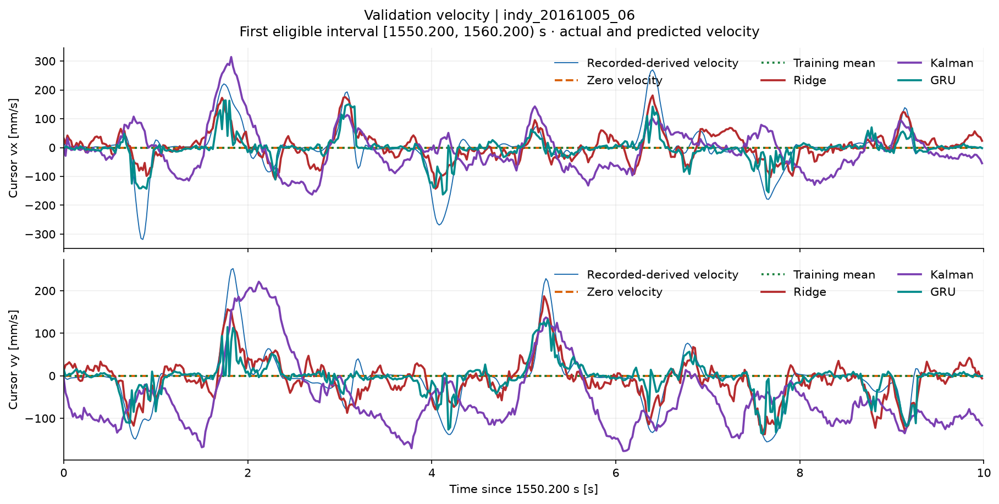
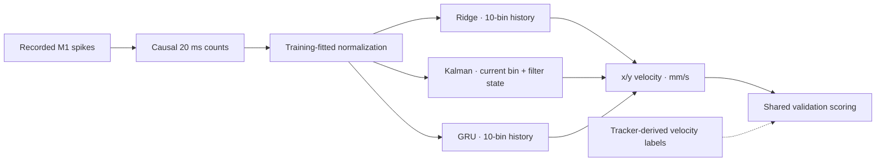

<a id="top"></a>

<p align="center">
  
</p>

<p align="center">
  <strong>Can a small neural network beat a well-built linear decoder?</strong><br>
  Explore movement decoding from real motor-cortex recordings, with reproducible experiments and visible results.
</p>

<p align="center">
  <a href="#results">See the results</a> &nbsp;·&nbsp;
  <a href="#quickstart">Get started</a> &nbsp;·&nbsp;
  <a href="#reproduce-the-comparison">Run the comparison</a> &nbsp;·&nbsp;
  <a href="docs/methods.md">Explore the methods</a>
</p>

<p align="center">
  <a href="https://www.python.org/"></a>
  <a href="https://pytorch.org/"></a>
  <a href="https://scikit-learn.org/"></a>
  <br>
  <a href="https://numpy.org/"></a>
  <a href="https://www.h5py.org/"></a>
  <a href="https://matplotlib.org/"></a>
  <a href="https://docs.astral.sh/uv/"></a>
  <a href="https://docs.pytest.org/"></a>
  <a href="https://docs.astral.sh/ruff/"></a>
</p>

---

## The idea

NeuroDecode learns to estimate **x/y cursor velocity from recorded neural spikes**.
One public reaching session, three decoder families, and the same scoring timestamps:
a compact experiment in how model complexity translates into decoding accuracy.

| 🧠 Real neural recordings | ⚖️ Three ways to decode | 🔍 Inspect every step |
| :--- | :--- | :--- |
| 96 motor-cortex channels from a public nonhuman-primate reaching task. | Ridge regression, a NumPy Kalman filter, and a 12,546-parameter PyTorch GRU. | Source checksums, chronological splits, frozen preprocessing, and saved prediction audits. |

In the original experiment, a monkey's tracked hand movement controlled the cursor
while implanted electrodes recorded spikes. Here, the recordings are decoded
afterward. Tracker-derived velocity supplies the training and scoring labels.

## Results

**Ridge leads this experiment: 27.8% lower validation RMSE than the zero-velocity baseline.**
The GRU beats the trivial baselines, but all three declared seeds trail ridge.

| Decoder | Overall RMSE ↓ (mm/s) | Mean R² ↑ | Explore |
| :--- | ---: | ---: | :--- |
| **Ridge regression** | **52.571** | **0.480** | [Fit and selection](reports/phase3b_ridge.md) |
| Causal GRU · seed 2026 | 54.792 | 0.434 | [All seeds and learning curves](reports/phase5b_gru.md) |
| Zero velocity | 72.817 | ≈ 0 | [Baseline report](reports/phase3a_baselines.md) |
| Training-mean velocity | 72.818 | ≈ 0 | [Baseline report](reports/phase3a_baselines.md) |
| Linear Gaussian Kalman | 102.839 | −1.103 | [Filter diagnostics](reports/phase4b_kalman.md) |

All five predictors score the **same 2,775 eligible validation rows** from one
recording. Validation selects model settings and GRU checkpoints; these are
**development results**. Final test evaluation remains unopened.
The selected GRU setting averages **55.264 ± 0.435 mm/s** across seeds 2026–2028
(mean ± population standard deviation).

<a href="reports/phase5b_gru.md">
  
</a>

<details>
<summary><strong>Read the plot and understand the scores</strong></summary>

The figure uses the fixed first ten seconds of eligible validation time, with no
smoothing or time shift. The table scores the full validation partition.
Lower RMSE means smaller velocity errors; mean R² averages the two axis scores.
A negative R² means the decoder performs worse than predicting that axis's
validation mean.

The GRU's seed spread measures initialization and training-order variability,
not variation across sessions or subjects. It is not a confidence interval.
See the [full comparison](reports/phase5b_gru.md) for missed peaks,
generalization gaps, and every declared run.

</details>

## How it works



The pipeline splits time **70 / 15 / 15** before building examples, leaves boundary
gaps, and fits preprocessing only on training data. Each prediction estimates
velocity for the just-completed bin. Held-out movement labels enter scoring;
they do not enter decoder inference. [Timing and causality contract →](docs/methods.md)

## Quickstart

**Python 3.11 · uv 0.12.23 · CPU-first**

<details open>
<summary><strong>Windows PowerShell</strong></summary>

Install the pinned uv version if it is missing, then reopen PowerShell if needed:

```powershell
py -m pip install --user uv==0.12.23
```

```powershell
git clone https://github.com/habibbumbus/neuro-decode.git
cd neuro-decode
uv python install 3.11
uv sync --locked
uv run --locked pytest
```

</details>

<details>
<summary><strong>macOS / Linux</strong></summary>

Install uv 0.12.23 using the [setup guide](docs/reproduction.md#macos--linux), then:

```bash
git clone https://github.com/habibbumbus/neuro-decode.git
cd neuro-decode
uv python install 3.11
uv sync --locked
uv run --locked pytest
```

These platform instructions have not been executed in this checkout.

</details>

Tests use small synthetic fixtures and **do not require the recording**.
The lockfile selects CPU PyTorch on Windows/Linux; macOS uses PyPI.
For editor setup, environment verification, and cache troubleshooting, see the
[complete setup guide](docs/reproduction.md).

## Reproduce the comparison

First acquire `indy_20161005_06.mat` using the
[dataset and checksum instructions](docs/dataset.md), and place it under `data/raw/`.
Raw recordings and generated runs stay outside Git.

<details>
<summary><strong>1 · Inspect the recording and prepare causal features</strong></summary>

Run from the repository root after setup and verified data acquisition:

```powershell
uv run --locked python scripts/inspect_recording.py data/raw/indy_20161005_06.mat
uv run --locked python scripts/plan_splits.py
uv run --locked python scripts/bin_recording.py --features
```

This establishes chronological partitions, 20 ms spike counts, aligned velocity
labels, ten-bin histories, and the frozen training-only scaler. Training inputs
have shape `[13070, 10, 96]`; velocity targets have shape `[13070, 2]`.

[Preparation details and component audits →](docs/reproduction.md#component-and-experiment-reference)

</details>

<details>
<summary><strong>2 · Evaluate baselines, fit ridge, and evaluate Kalman</strong></summary>

```powershell
uv run --locked python scripts/evaluate_baselines.py phase3a-baselines
uv run --locked python scripts/train_ridge.py phase3b-ridge
uv run --locked python scripts/fit_kalman.py phase4a-kalman-fit
uv run --locked python scripts/evaluate_kalman.py phase4b-kalman-audited
```

Keep these run names for the next step: the GRU reads the selected ridge artifact
and audited Kalman comparison from these paths. Existing run outputs are
preserved; use the [command reference](docs/reproduction.md) when choosing
alternate names and explicit artifact arguments.

[Why Kalman underperforms here →](reports/phase4b_kalman.md)

</details>

<details>
<summary><strong>3 · Train the GRU and audit its saved results</strong></summary>

```powershell
uv run --locked python scripts/train_gru.py phase5b-gru
uv run --locked python scripts/audit_gru.py phase5b-gru
```

Requires steps 1–2, including `runs/phase2d/count_scaler.json`,
`runs/phase3b-ridge/`, and `runs/phase4b-kalman-audited/`.
The [declared experiment](configs/gru_experiment.toml) compares two learning rates,
then repeats the selected setting at two additional seeds, within a four-fit
budget. The audit recomputes prediction metrics and verifies saved provenance.

[Full experiment protocol and results →](reports/phase5b_gru.md)

</details>

## Explore the repository

| I want to… | Start here |
| :--- | :--- |
| Understand the experiment | [Project brief](docs/project_brief.md) |
| Inspect the data source, license, and schema | [Dataset card](docs/dataset.md) · [Checksum manifest](data/manifest.json) |
| Check splits, equations, and leakage controls | [Methods](docs/methods.md) |
| Follow every setup and experiment command | [Reproduction guide](docs/reproduction.md) |
| Read the implementation | [Python package](src/neurodecode/) · [Runnable scripts](scripts/) |
| Change declared model settings | [TOML configurations](configs/) |
| Inspect the evidence | [Experiment reports](reports/) · [Component tests](tests/) |
| See what is finished and what comes next | [Progress](docs/progress.md) · [Decisions](docs/decisions.md) |

## What's next

- [x] Verified recording, causal features, and chronological evaluation protocol
- [x] Baselines, ridge, Kalman, and a declared three-seed GRU comparison
- [ ] Offline versus sequential replay agreement and measured processing latency
- [ ] Visual cursor replay and controlled robustness experiments
- [ ] Frozen final test evaluation

<details>
<summary><strong>Scope, dataset attribution, and licensing</strong></summary>

This is an independent educational project using one recorded nonhuman-primate
session. It does not establish live closed-loop control, human performance, or
clinical usability. Cross-session generalization and inference latency remain
unmeasured. A future cursor replay will be labeled as offline recorded-data replay.

**Dataset:** O'Doherty, J. E., Cardoso, M. M. B., Makin, J. G., & Sabes, P. N. (2017).
*Nonhuman Primate Reaching with Multichannel Sensorimotor Cortex Electrophysiology*
(v1). [Zenodo · DOI 10.5281/zenodo.583331](https://doi.org/10.5281/zenodo.583331).
Source data is licensed under [CC BY 4.0](https://creativecommons.org/licenses/by/4.0/).
See the [dataset card](docs/dataset.md) for acquisition and attribution details.

**Code:** a license has not yet been chosen for this repository.

</details>

<p align="center">
  <a href="#top">Back to top ↑</a>
</p>
