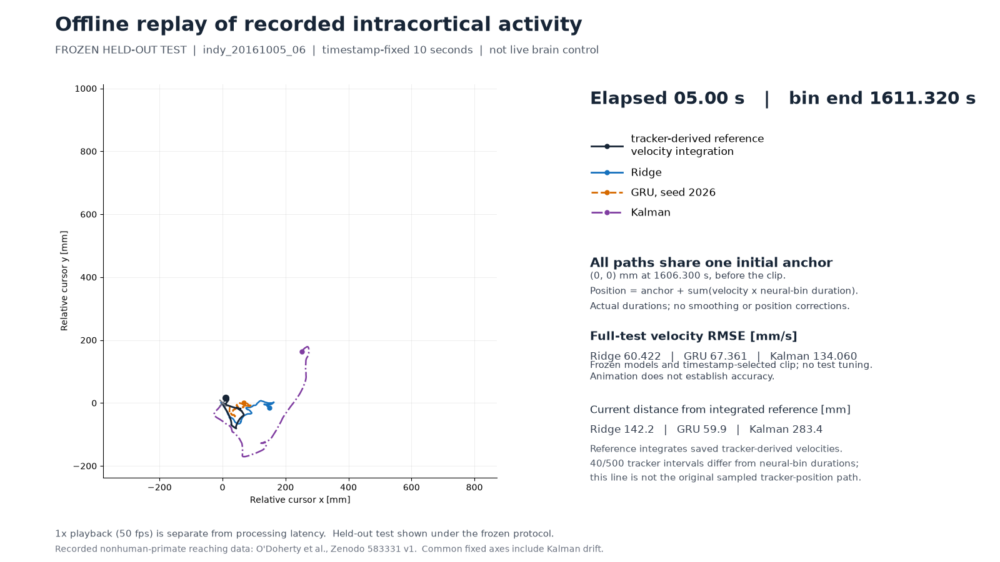

# Validation cursor replay — Phase 6C

This first section is the preserved validation-development record. The current
held-out preview/video is documented in [the Phase 7B/7C section below](#held-out-preview-and-video-phase-7b7c).

This is a ten-second **offline replay of recorded intracortical activity**, not
live brain control. It uses the fixed first validation interval
[1550.200,1560.200) s from earlier figures, without selecting a favorable clip.
The test partition remains closed. No models are fitted, tuned or run by the
renderer: it consumes verified clean sequential Phase 6A predictions.

## Recreate the video and still

From the repository root with the locked Python environment, acquired recording,
saved Phase 6A inputs/checkpoints and existing FFmpeg/ffprobe on PATH:

~~~powershell
uv run --locked python scripts/render_cursor_replay.py phase6c-review
uv run --locked python scripts/audit_cursor_replay.py phase6c-review
~~~

Use a new run ID; existing media folders/verification files are refused.
The actual final run is runs/phase6c-validation-cursor-final. Its outputs are:

- cursor_replay.mp4: H.264, 1600×900, yuv420p, 50 fps, 500 frames, exactly 10 s.
- still.png: the predetermined middle frame, index 250 at 1555.200 s, elapsed 5 s.
- frame_first/middle/last.png and encoded_frame_01/02/03.png: source renders and
  actual decoded MP4 frames for visual inspection.
- positions.csv: common initial anchor plus 500 integrated endpoints, all paths.
- alignment.csv: original tracker source times/positions and actual bin durations.
- inputs.json: source/split/target/channel/prediction/model identities, hashes,
  alignment audit, settings, library/export-tool versions and actual Git/code state.
- run.json and verification.json: fixed axes, video probe, artifact hashes,
  trajectory audit and terminal distances.

Every generated file stays under ignored runs/. Do not stage the video, PNGs,
raw recordings, checkpoints or CODEX.md. The renderer uses existing matplotlib,
Pillow and FFmpeg; no Python dependency was added. Existing FFmpeg build is
N-122609-g364d5dda91-20260131. Fresh machines need their own compatible FFmpeg
installation; that setup was not tested here.

## What the reference and timing mean

The on-screen reference is explicitly **tracker-derived reference velocity
integration**, not the original tracker-position trace. All saved target
velocities match the original tracker differences divided by their actual
selected behavioral intervals exactly. But 40 of 500 behavioral intervals are
16/24 ms instead of the neural bins' approximately 20 ms, with source age up to
4 ms. Source endpoints chain correctly, yet integration over neural-bin durations
differs from original sampled tracker positions by up to 0.822694 mm per coordinate.
Therefore exact original-position alignment is not asserted.

For every path, displacement for bin i is velocity_i × (bin_end_i − bin_start_i).
Start from one relative origin (0,0) mm at 1550.180 s, the first selected bin's
start. The 500 selected prediction timestamps are 1550.200 through 1560.180 s,
all inside the fixed half-open interval. The first displayed point has already
integrated the first completed bin. The initial anchor is context, not an extra
frame outside the requested interval. The last frame's elapsed time is 9.98 s;
holding each of 500 frames for 1/50 s makes a 10-second video. Actual integrated
bin durations sum to 10 s from the pre-clip anchor to the last endpoint.

No smoothing, shift, snap, repeated anchoring, reference-position correction
or interpolation is applied. Missing bins, nonfinite values, unordered IDs,
nonshared edges or segment changes cause explicit failure, not an alternative
clip or a bridged path. The actual fixed clean clip has no such discontinuity.

## Reading the display honestly

Reference, ridge, seed-2026 GRU and Kalman have the same fixed physical-unit
axes and equal x/y scale, covering every complete path including Kalman drift.
Bounds are chosen once from these fixed validation paths and never change with
the frame; they do not enter decoder computation. Current distance from the
integrated reference is illustrative. Full-validation velocity RMSE remains
ridge 52.571, GRU 54.792, Kalman 102.839 mm/s on the original 2775 rows.

The shorter clip's final distances (43.8395/42.4195/441.3465 mm) do not establish
that GRU beats ridge: integrated errors can cancel, and one endpoint is not the
declared validation metric. An attractive trajectory does not prove decoding
accuracy. At inference time the models have completed neural bins and their
declared state/history, never movement labels or later reference positions.
Playback rate is unrelated to measured processing latency; see the Phase 6A
report. This video is not a new latency measurement or a live BCI demonstration.

The first, middle and last decoded video frames were visually checked for
labels, timing, common axes and visible drift. There were no cropped paths or
automatic recentering. The initial export was preserved; the final export only
tightened sidebar text/capitalization and has identical positions.csv bytes.
All 332 tests passed, including 13 new integration/alignment/gap checks.
Independent artifact audit verifies hashes, anchor equality and every exported
displacement against saved velocities (maximum residual 2.842171e-14 mm).
FFprobe verifies frame count, dimensions, rate and duration. No final-test score.

## Held-out preview and video (Phase 7B/7C)

The completed frozen held-out video is
`runs/phase7b-final-test/cursor_replay.mp4`, preserved under ignored runs/.
It uses the timestamp-only interval **[1606.320,1616.320) s** selected before
test access, not a replacement clip chosen for appearance. No video or test
inference was rerun for Phase 7C; only an existing small still was copied.

The README preview is a byte-for-byte copy of the original run's `still.png`,
also identical to its `frame_middle.png`: frame 250, elapsed 5.000 s, bin end
1611.320 s. It was visually inspected and checked against the run's saved artifact
hash. File size 139,724 bytes; SHA-256
`4c017df3e63b1ae99b398f87174e1f51ec65a84926d3c404d1c5ab0907a9a1bb`.
The [small provenance JSON](assets/phase7b-replay-still.json) records source/run/
freeze identities and the absence of image transforms. This is the actual
predetermined rendered still, not an AI illustration or a new selected example.

The ten-second MP4 has 500 frames at 50 fps and 1600×900 dimensions. Its label
says **offline replay of recorded intracortical activity**, frozen held-out test,
not live brain control. Reference, ridge, seed-2026 GRU and Kalman share fixed
physical axes and a single relative zero anchor at 1606.300 s. Position increments
are predicted velocity times actual neural-bin duration, with no smoothing,
shifting, snapping, periodic reset or future reference correction. Kalman's
large drift remains visible, so the other trajectories appear small on the
common scale. Do not crop/rescale individual models to improve the comparison.

The reference is **tracker-derived reference velocity integration**, not the
original sampled tracker-position path. The existing alignment audit found
40/500 behavioral intervals differ from neural-bin durations; exact tracker-grid
alignment is not established. Positive velocity R² does not prove position
accuracy, and local endpoint closeness cannot replace the full-block RMSE.
The [final report](../reports/phase7b_final.md) retains every model's complete
scores and the actual encoded first/middle/last-frame inspection evidence.

To review the full local video, restore the original trusted evidence folder
as described in [reproduction](reproduction.md#restore-the-exact-frozen-bundle).
No public MP4/artifact release currently exists. Never force-add the MP4 or bulk
runs. Read-only artifact auditing and the recorded archival export/evaluation
command are documented there; don't rerun test or delete outputs to regenerate
a prettier demo. Playback speed, acquisition-bin duration and measured processing
latency are different quantities. This is not closed-loop control or a hard
real-time guarantee.

## Suggested 85-second interview walkthrough

This is a narration/presentation plan using existing verified media, not a new
85-second export or another experiment. Timing is approximate; practice aloud.
Keep validation robustness and held-out accuracy visibly distinguished.

| Elapsed | Show | Suggested narration |
| --- | --- | --- |
| 0–15 s | README experiment description | “These are implanted motor-cortex spike recordings while a monkey reaches. The tracked hand controlled the original cursor; that movement supplies our labels. We decode the recording afterward.” |
| 15–30 s | Causal pipeline and split | “Completed count bins feed a training-fitted scaler and frozen decoders. Ridge and GRU use bounded history. We selected settings on validation before freezing test artifacts, scoring rows and this clip.” |
| 30–40 s | Play the existing ten-second held-out MP4 once | “This is offline replay. The reference integrates tracker-derived target velocity. Every path has one common anchor; no later position corrections hide drift.” |
| 40–55 s | Full held-out result table | “Ridge has the lowest declared overall velocity RMSE: about 60.42 mm/s, versus GRU 67.36. Kalman is worse than the trivial baselines. A locally closer path does not replace that full-block metric.” |
| 55–70 s | Existing [validation channel-loss trace](../reports/figures/phase6b_channel_loss_trace.png) and [robustness report](../reports/phase6b_robustness.md) | “This separate validation-only simulation disables a predefined physical-channel subset. It tests sensitivity under a documented policy, not actual biological electrode instability or test robustness.” |
| 70–85 s | Limitations and reproduction boundary | “These are correlated examples from one session and one held-out time block. We have no cross-session, human or live-control evidence. Source and tests are public; exact historical model artifacts and the full video are not currently a public download.” |

Use the fixed existing clip/trace rather than selecting a new favorable interval.
Do not relabel the validation disruption plot as held-out test evidence. The
public still is available without the ignored bundle; playing the full MP4
requires the existing trusted local evidence as described above.
