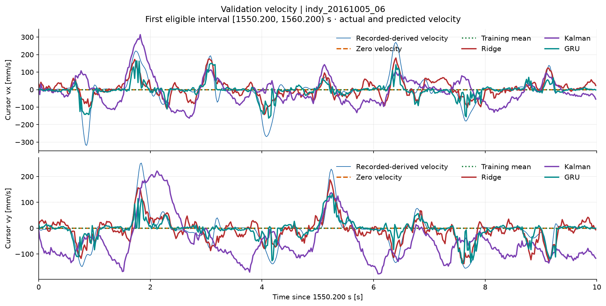
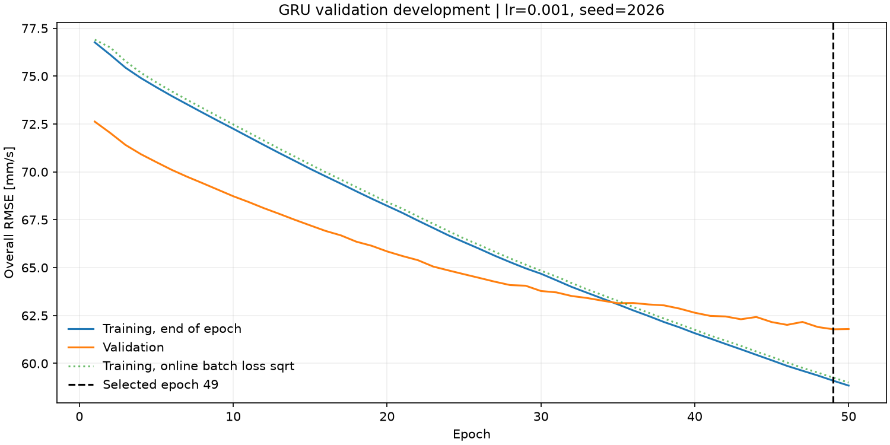
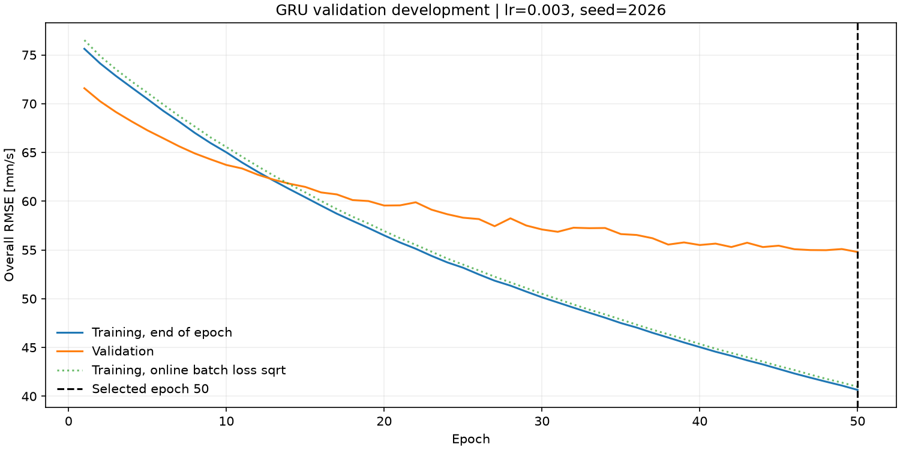
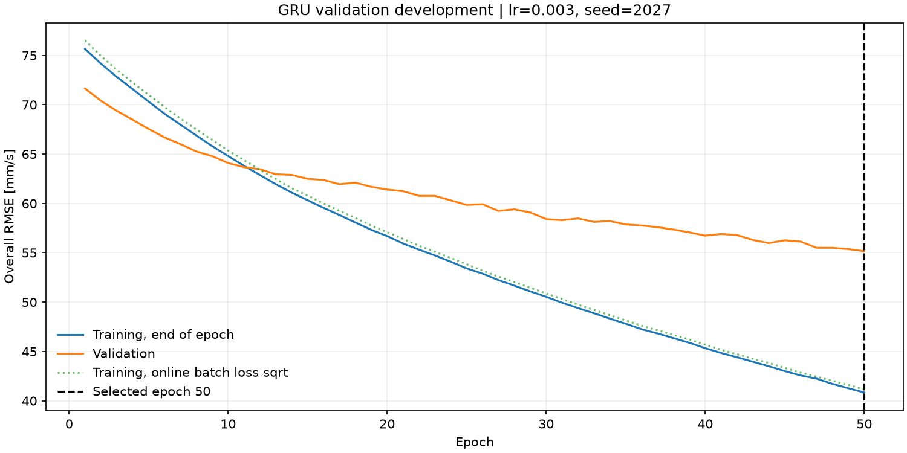
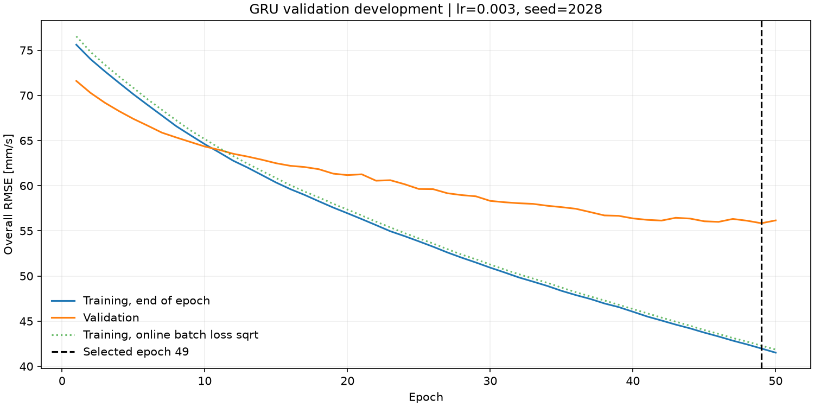

# Phase 5B: real-data GRU validation

## Predeclared experiment plan (2026-11-17, before training)

Round 1 compares learning rates 0.001 and 0.003 with selection seed 2026.
The first candidate is the actual Phase 5A default. The second tests a modestly
faster update rate under the same short budget. No further candidates will be
added based on disappointing results; another round would require a new explicit
exploratory declaration. Machine-readable plan: configs/gru_experiment.toml;
component settings: configs/gru.toml. The runner saves both before fitting.

Architecture: one unidirectional GRU, 96 inputs, ten oldest-to-newest 20 ms bins,
hidden size 32, a linear two-output head, zero hidden state per independent
window, 12,546 parameters. CPU float32, one thread, deterministic algorithms.
Adam betas 0.9/0.999, epsilon 1e-8, weight decay 0, batch 256, gradient norm cap 1,
maximum 50 epochs, patience 8, strict improvement threshold 0 mm/s. No scheduler,
target scaling, continuous hidden state, channel selection, or lag changes.
The 250-epoch synthetic fixture and its learning rate 0.02 are excluded.

Primary metric: validation overall RMSE in mm/s, computed by the existing shared
scorer across all rows and both axes. Each run restores the earliest epoch with
the strict minimum validation RMSE. Stop after eight non-improving epochs.
Select the learning rate using only seed 2026; candidates within absolute
1e-9 mm/s of the minimum tie, choosing the lower learning rate. No test selection.

After setting selection, repeat only that setting with predeclared seeds 2027
and 2028. Report every seed plus arithmetic mean and population standard
deviation of scores, not only the best seed. Seed 2026 is the preselected
representative checkpoint/trace, regardless of which seed performs best.
Selection uses seed 2026, so the seed mean is a development summary, not an
unbiased final accuracy estimate or a confidence interval across sessions.

Maximum budget: four fits, 200 total epochs, 10,400 optimizer updates
(52 batches per epoch for 13,070 examples), one CPU thread. A shared 1,200-second
training deadline is checked before epochs; an in-progress epoch may finish.
Preparation/export/checks are outside this training budget and are not latency
measurements. If the deadline expires, preserve completed work, mark incomplete
or unrun configurations explicitly, and do not extend the search.

Reuse exact Phase 2D training-only normalization, windows/channel order/units,
targets and partitions. Verify the frozen scaler against a training-only refit.
Train on 13,070 eligible training windows; score every predictor on the same
2,775 validation timestamps/targets/masks. No test windows, targets, predictions,
metrics or plots are constructed. The common source loader reads the recording
and global metadata, as in prior phases.

Training MSE supplies gradients; validation only selects saved weights/settings.
Keep online batch training MSE and end-of-epoch train/validation shared metrics.
Fixed velocity plot: [1550.200,1560.200) s, the earlier models' first eligible ten
seconds, 500 rows, without smoothing or display shift. Save learning curves for
every completed run, all seed predictions, trusted local checkpoints, complete
provenance and checkpoint reload equality under ignored runs/.

## Measured results

All four declared fits completed in runs/phase5b-gru-round1. Each ran 50 epochs;
none reached patience 8. Total 200 epochs / 10,400 optimizer updates; whole
preparation/training/export took 85.422 seconds. Individual fit/export durations
were 21.266, 20.688, 20.234 and 20.438 seconds. The deadline did not bind.
All declared configurations were run; none were added, skipped or extended.
These durations are not inference latency or a controlled runtime benchmark.

| Learning rate | Seed | Role | Best epoch | Epochs run | Train overall RMSE | Validation overall RMSE |
| ---: | ---: | --- | ---: | ---: | ---: | ---: |
| 0.001 | 2026 | Setting selection | 49 | 50 | 59.098304 | 61.782268 |
| 0.003 | 2026 | Setting selection / representative | 50 | 50 | 40.647875 | 54.791919 |
| 0.003 | 2027 | Selected-setting seed repeat | 50 | 50 | 40.842553 | 55.157982 |
| 0.003 | 2028 | Selected-setting seed repeat | 49 | 50 | 41.971682 | 55.842133 |

RMSE is mm/s throughout. Train scores use the restored checkpoint on the
13,070 training examples. They are not generalization estimates. Learning rate
0.003 won using seed 2026 before additional seeds ran. Epoch 50 had its strict
minimum validation overall RMSE; this selected checkpoint is not an early-stop
event. The other candidate's epoch 49 beat its epoch 50, so epoch 49 was restored.
The same earliest-minimum rule selected epoch 49 for seed 2028.

## Matched validation comparison

Every row below scores the same 2,775 targets, ending 1550.200–1605.680 s.
GRU has 12,546 trainable parameters and uses the preselected representative seed
2026, rather than choosing the best seed after the fact. Reference predictions
are reused unchanged from verified Phase 4B CSV bytes. The selected ridge model
was also loaded and reproduced its saved predictions exactly. Kalman was not
refit or retuned. Shared evaluate_velocity computes every model's scores.

| Predictor | N | RMSE x | RMSE y | Overall RMSE | R² x | R² y | Mean R² |
| --- | ---: | ---: | ---: | ---: | ---: | ---: | ---: |
| Zero velocity | 2775 | 78.418547 | 66.748063 | 72.817486 | -0.000000210 | -0.000000024 | -0.000000117 |
| Training mean | 2775 | 78.418755 | 66.748186 | 72.817654 | -0.000005500 | -0.000003691 | -0.000004595 |
| Ridge, lambda=1000 | 2775 | 56.844212 | 47.919052 | 52.571380 | 0.474546 | 0.484606 | 0.479576 |
| Kalman | 2775 | 93.653913 | 111.267523 | 102.838507 | -0.426311 | -1.778814 | -1.102563 |
| GRU, lr=0.003, seed=2026 | 2775 | 58.990834 | 50.243310 | 54.791919 | 0.434111 | 0.433397 | 0.433754 |

Overall RMSE = sqrt(mean squared error over all rows and both axes); mean R²
is the unweighted mean of the two per-axis scores. GRU beats both trivial
baselines and Kalman, but all three seeds underperform ridge. This is retained
without further tuning. Validation selected settings/checkpoints; these are
development results, not final test results or independent session replications.

## Every seed and spread

Each seed has N=2775, 12,546 parameters, and the selected learning rate 0.003.
No ensemble is formed; summary entries average the per-run scores.

| Seed | RMSE x | RMSE y | Overall RMSE | R² x | R² y | Mean R² |
| --- | ---: | ---: | ---: | ---: | ---: | ---: |
| 2026 | 58.990834 | 50.243310 | 54.791919 | 0.434111 | 0.433397 | 0.433754 |
| 2027 | 58.620167 | 51.463403 | 55.157982 | 0.441200 | 0.405544 | 0.423372 |
| 2028 | 60.889406 | 50.290833 | 55.842133 | 0.397099 | 0.432324 | 0.414712 |
| Arithmetic mean | 59.500136 | 50.665849 | 55.264011 | 0.424136 | 0.423755 | 0.423946 |
| Population std (ddof=0) | 0.993949 | 0.564290 | 0.435254 | 0.019336 | 0.012885 | 0.007784 |

These three seeds vary initialization and training-window permutations. They
do not sample new subjects, recording sessions, or independent time blocks.
No confidence interval or significance claim follows from their spread.

## Fixed traces and learning curves

The plot uses exactly the earlier models' interval [1550.200,1560.200), 500
samples, unshifted and unsmoothed. Near-zero baseline lines nearly overlap.
GRU follows some reversals but misses large peaks. Visual review confirmed
physical units, common time offsets and all predictor labels.

Blue and orange curves below use the same weights at the end of each epoch.
The dotted curve is sqrt(online batch-averaged MSE), whose weights change
throughout the epoch. JSON history retains full train/validation per-axis
metrics; CSV retains online training MSE and end-of-epoch overall RMSE plus
validation MSE. Squared end-of-epoch RMSE is the corresponding MSE.

## Diagnosis and limitations

At the representative checkpoint, training RMSE 40.647875 is lower than
validation RMSE 54.791919 by 14.144044 mm/s. Training keeps improving faster
than validation, suggesting increasing fitting to the training partition.
However, validation still improves overall toward epoch 50, with small
fluctuations, rather than a sustained worsening trend. There is a generalization
gap and possible overfitting, but no demonstrated point where extra epochs
systematically hurt validation. We do not claim convergence, extend the budget,
or assert that more epochs would beat ridge.

Representative validation prediction-minus-target bias is [0.574844,0.514901]
mm/s, much too small to explain the RMSE alone. Prediction population standard
deviation is [46.077351,39.541700] versus targets [78.418539,66.748062] mm/s.
Training and every repeat's bias/spread are saved in run.json. The weak default
candidate has even smaller validation spread [24.958648,22.309068] mm/s.

A concrete checkpoint limitation explains some missed extremes. Starting from
zero, each GRU hidden component remains in [-1,1]. With the saved linear head,
each output must lie between bias minus/plus the sum of absolute head weights.
For seed 2026, these mathematical bounds are x [-163.347843,166.658504] and
y [-137.804769,134.351206] mm/s. Exactly 192/2775 (6.9189%) targets on each axis
fall outside those bounds. The validation target ranges are x
[-382.867047,408.978133] and y [-364.238502,385.551269] mm/s. These extreme
targets cannot be matched by this checkpoint even with an ideal hidden state.
This is a bound imposed by the weights actually learned under the short budget,
not a permanent speed limit of every possible H32 GRU. Unscaled targets require
learning a large output scale. No target scaling or extra training was introduced
after observing this result. This bound does not explain all errors or prove
the cause of ridge's advantage.

Units remain unscaled mm/s for loss/output/scoring. The training-only frozen
scaler matches Phase 2D exactly. Adapters preserve all consecutive source bins,
oldest-to-newest order and the final-bin target identity. Every exported source
window endpoint, timestamp, mask and target matches earlier models. Existing
order/causality and held-out-mutation tests pass. No concrete unit, alignment,
label leakage or numerical defect was found. Limited optimization/output scale,
training-specific fitting and temporal distribution differences are plausible
limitations; the latter two are not established causal explanations.

One chronological validation interval in one session does not establish final
test performance, cross-session quality, calibrated uncertainty or closed-loop
control. Overlapping bins are correlated. Kalman's persistent causal state has
different memory from bounded ten-bin ridge/GRU histories even with identical
score rows. Physical synchronization and tracker discrepancies remain as noted
in the dataset card. Replay equivalence, latency, robustness and cursor video
are not implemented or measured in this phase.

## One real prediction

Use the first eligible validation row, global bin ID 13110, ending 1550.200 s.
Its count history covers (1550.000,1550.200], with final neural bin
(1550.180,1550.200]. The recorded-derived target is associated with that final
bin. All ten M1 001 counts happen to be zero; each becomes -0.353559911 in
float32 using training statistics. The other 95 channels are also supplied.

Batch [1,10,96] and fresh h0 [1,1,32] produce recurrent output [1,10,32] and
final hidden state [1,1,32]. The last hidden vector [1,32] passes through the
linear head to [1,2] mm/s. For lr=0.003, seed 2026, epoch 50:

- Prediction [vx,vy]: [-3.388826609,15.284593582] mm/s.
- Actual derived target: [14.162167438,3.788288106] mm/s.
- Signed error, prediction minus actual: [-17.550994047,11.496305476] mm/s.

The actual target is used only after prediction for scoring. This first row is
retained by chronological identity despite its wrong x direction; it is not a
favorable example. Its two errors are not the full-validation RMSE.

## Provenance, verification and reproduction

Base commit f405c158800d476fd275991429bc4058c08d6c18, actual branch main;
implementation was dirty/uncommitted. Phase 5A is committed and was verified on
GitHub before this phase; its older progress note saying uncommitted is historical.
Training metadata record Git status and actual LF-normalized implementation
hashes, so these results are not attributable to the base commit alone.
The later artifact-only audit has its own code hash in verification.json.

Source session indy_20161005_06, Zenodo 583331 v1; SHA-256
4b023e668d641960c7e3f4d277c781e606013125013a4cead1f4731951ff8eac.
Canonical split hash:
3e54457065c7bf9d71fb2eef4a5bf7710d7d498fbf84bf1995d59ad11107ee13.
Frozen normalization hash:
603aa299f0a1d75625acea41a18b9ecf56c58e4e0515ec8322ea1aa34abe68dd.
Eligible validation identity hash:
30446619fcf5a2d49ada8bff99ac8616247a255e13a68a7c4b1836171c9875c1.
Source/split/target identities, all channel/unit mappings, full frozen transforms,
effective settings/seeds and environment versions are in the parent run.json.

Executed environment: Windows build 26300, Intel64 Family 6 Model 186 Stepping 2,
20 logical CPUs available, one training/native thread, CPU float32, deterministic
torch algorithms. Python 3.11.17; torch 2.14.1+cpu (CUDA unavailable), NumPy 2.4.6,
SciPy 1.17.1, scikit-learn 1.7.2, h5py 3.16.0, Matplotlib 3.11.2,
threadpoolctl 3.7.0; uv 0.12.23. No dependency changed or new data downloaded.

Each run saves trusted local gru.pt, selected-checkpoint metadata/history,
history.json, learning_curve.csv, learning_curves.png, timestamped predictions
and metrics/diagnostics. Parent files include the immutable predeclared plan,
selection.json (written before repeats), five-model predictions, metrics,
velocity plot, run.json and verification.json. Full tensors/runs stay ignored;
only these curated report images are intended for Git.

Checks completed:

- Every frozen reference row, target, mask and source window endpoint matched;
  reference artifact hashes and shared scorer outputs matched exactly.
- Selected ridge artifact reload reproduced the original ridge predictions.
- Every GRU checkpoint reload reproduced its validation predictions exactly.
- Independent NumPy recalculation from every GRU CSV agrees with stored RMSE/R²
  within 1e-12; all recorded artifact hashes were verified.
- Validation labels are absent from forward/prediction inputs, normalization
  fitting, backward and optimizer steps. Synthetic mutation tests confirm
  unchanged one-epoch weights/transforms when validation labels change. Labels
  legitimately affect checkpoint/settings selection and stopping across epochs.
- All 269 tests passed (260 retained plus nine new checks), including deadline,
  end-of-epoch train metrics, setting ties and reference corruption/alignment.
  Ruff lint/format and offline lock consistency passed after fixing a test
  module import and its import order. No test data enters CI/tests.
- No test-partition windows, targets, predictions, metrics or plots were made.
  Existing source/global metadata loading is not a claim of never reading its bytes.

Run from the repository root after the existing local source/scaler/reference
artifacts are available. Use a new run ID; existing output directories and
verification files are refused to preserve prior evidence:

~~~powershell
uv run --locked python scripts/train_gru.py phase5b-review
uv run --locked python scripts/audit_gru.py phase5b-review
uv run --locked pytest -p no:cacheprovider
uv run --locked ruff check .
uv run --locked ruff format --check .
uv lock --check --offline
~~~

The experiment command actually executed was
`.venv/Scripts/python.exe -u scripts/train_gru.py phase5b-gru-round1`; the
artifact audit used the same interpreter and run ID. The commands above reproduce
under the locked environment, but fresh-checkout/cross-platform execution was
not tested. Recreate missing Phase 2D/3B/4A/4B artifacts with their documented
commands without opening final test scoring. Only trusted project checkpoints
are loaded; no remote model deserialization or optimizer resume is needed.

Stop at Phase 5B. Next increment: verify offline versus sequential replay with
the same independent-window resets, then measure processing latency before
building the cursor video. No additional GRU search round is scheduled here.
