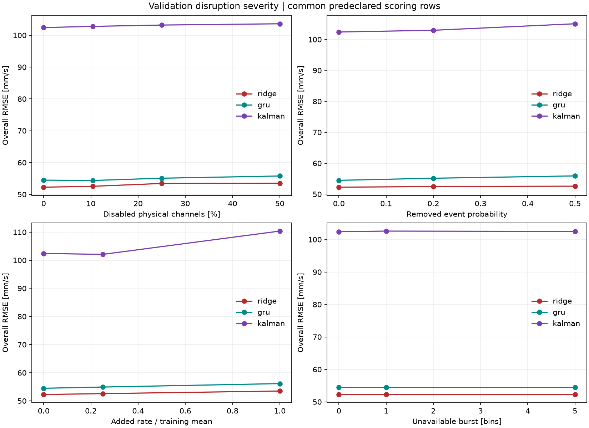
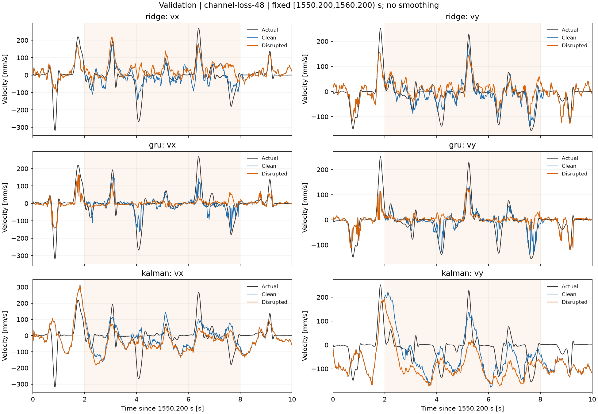
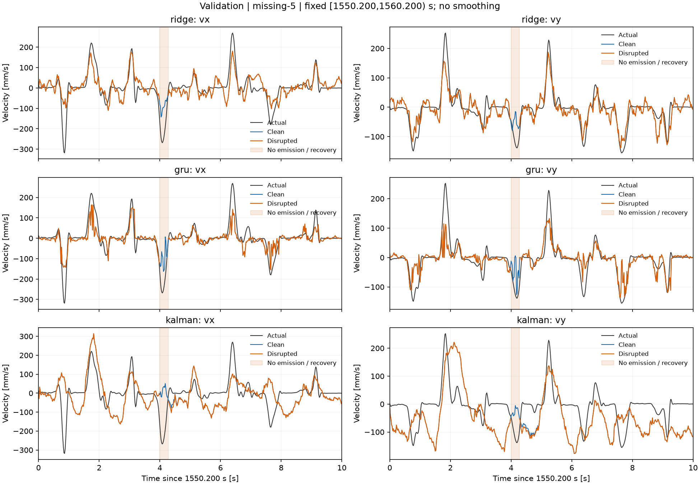

# Phase 6B: controlled validation input disruptions

## Predeclared round 1 (2026-11-18, before disrupted inference)

Run the fixed ten conditions in configs/robustness.toml: clean; physical channel
loss of 10/24/48 channels; binomial thinning with retention 0.8/0.5; independent
Poisson additions with lambda=0.25/1.0 times the frozen per-channel training
mean raw count; and missing bursts of one/five bins. Three frozen decoders,
one representative GRU seed 2026, no retraining, new settings or extra conditions.
The runner saves exact identities, transforms, masks and effective manifest
before the first replay. All models receive the identical perturbed packet list.

Channel loss/count changes affect only source bin IDs [13210,13510), whose
end timestamps are [1552.200,1558.200) s: 300 completed bins, chosen by the
first eligible validation timestamp plus 2 through 8 seconds, not model quality.
Missing bursts begin at ID 13310, end time 1554.200 s (first eligible plus 4 s).
One bin is ID 13310; five bins are IDs 13310–13314, ends 1554.200–1554.280 s.
Perturb each source bin once before frozen normalization; overlapping histories
reuse the same perturbed counts. No target, time shift or scaler refit.

Channel ranking is ascending SHA-256 of
phase6b-channel-loss-v1|20261118|source_sha256|channel_id. Source SHA-256 is
4b023e668d641960c7e3f4d277c781e606013125013a4cead1f4731951ff8eac.
Select nested rank prefixes, without using activity, weights, labels or scores.
All source unit slots on a selected physical channel are disabled together.
10 channels is ceil(10% of 96)=10, or 10.4167%; other levels are 24/96 and 48/96.

Exact rank prefixes, in selection order:

- First ten: M1 012,022,002,059,015,018,053,071,009,046.
- Next fourteen, making 24: M1 048,025,091,077,066,014,050,081,016,067,036,094,013,055.
- Next twenty-four, making 48: M1 093,034,026,039,006,056,003,007,020,019,064,085,070,047,011,004,008,061,043,038,001,058,035,063.

Disabled counts become integer raw zeros. They remain valid observations and
normalize to (0 − training mean)/training scale, not generally standardized zero.
Some selected channels may already be silent; they are not replaced to amplify
the effect. Channel identities/order are retained across all history bins.

Thinning seed 20261119 draws Binomial(raw_count, retention), independently per
source/bin/channel identity. Poisson seed 20261120 adds nonnegative integer
draws with rates from frozen unique-bin training means only. A SHA-256 key
includes seed, source, partition, session, bin ID and physical channel ID, so
future packets and loop order do not change earlier perturbations. The same
family seed is used for both severity levels; no seed is selected by scores.
These are simple observation simulations, not validated biological drift models.

Missing packets explicitly have missing=True, counts=None and source_valid=False.
No hidden copy of unavailable counts reaches inference. All models retain
Phase 6A's skip/reset policy: no output on the missing bin, discard history,
and wait for ten subsequent valid bins. Kalman does not extrapolate in this
round; it resets to the training prior when the common history is ready.
GRU starts each resumed bounded window at zero, as always. This deliberately
compares the same missing policy, not alternative imputation strategies.

Primary scoring uses the same 2761 original rows for every model and condition:
remove the union of scheduled unavailable/recovery IDs 13310–13323 (14 rows).
One missing bin suppresses 13310–13319 (10 rows); five suppress 13310–13323.
The first resumed emissions are 13320 and 13324 respectively. No exclusions depend
on error or movement. Also report each condition's available-row metrics and
clean metrics on those exact rows: 2775 ordinary, 2765 one-bin loss, 2761 five-bin
loss. Report coverage so absent predictions are never mistaken for accuracy.
This score cannot quantify error on rows where the selected policy emits nothing.

Primary metrics are existing shared per-axis/overall RMSE in mm/s and per-axis/
mean R². Show accuracy versus the declared severities, including clean at zero.
Fixed traces use the earlier [1550.200,1560.200) s interval for preselected
channel-loss-48 and missing-5, no smoothing or flattering interval search.
No test windows, targets, predictions, scores or disruptions are constructed.

## Measured results

All ten declared conditions completed in runs/phase6b-disruptions-round1:
30 model/condition replays, zero failed conditions, no extra seeds, subsets,
severities or exploratory rounds. No declared condition remains unrun.

Clean predictions reproduce Phase 6A bit-for-bit on all original 2,775 rows;
shared metrics also reproduce exactly. Original full-population overall RMSE
is ridge 52.571380, GRU 54.791919, Kalman 102.838507 mm/s. The primary scores
below differ because the predeclared common mask removes 14 rows from every
condition, including clean. This is not an accuracy improvement in clean replay.

| Condition | Ridge overall RMSE | GRU overall RMSE | Kalman overall RMSE |
| --- | ---: | ---: | ---: |
| Clean | 52.262457 | 54.479093 | 102.415704 |
| Channel loss 10/96 | 52.544563 | 54.373814 | 102.788947 |
| Channel loss 24/96 | 53.437017 | 55.083326 | 103.205030 |
| Channel loss 48/96 | 53.490490 | 55.782373 | 103.607789 |
| Thin, retain 0.8 | 52.473815 | 55.156052 | 102.968828 |
| Thin, retain 0.5 | 52.591852 | 55.910255 | 105.071836 |
| Poisson, 0.25× training mean | 52.572650 | 54.915500 | 102.080639 |
| Poisson, 1× training mean | 53.501119 | 56.138973 | 110.360574 |
| One missing bin | 52.262457 | 54.479093 | 102.593141 |
| Five missing bins | 52.262457 | 54.479093 | 102.482924 |

All scores use the same 2,761 rows and RMSE units mm/s. Complete per-axis RMSE,
overall RMSE, per-axis R², mean R², scored/emitted counts and completion status
for every one of the 30 pairs are in the curated [metrics CSV](phase6b_metrics.csv).
Overall RMSE is sqrt(mean squared error over both axes/all scored rows);
mean R² is the unweighted axis mean. Every score uses existing evaluate_velocity.

| Condition | Ridge mean R² | GRU mean R² | Kalman mean R² |
| --- | ---: | ---: | ---: |
| Clean | 0.474878 | 0.428564 | -1.123055 |
| Channel loss 10/96 | 0.469850 | 0.431001 | -1.141886 |
| Channel loss 24/96 | 0.453897 | 0.417249 | -1.162626 |
| Channel loss 48/96 | 0.450884 | 0.401398 | -1.174802 |
| Thin, retain 0.8 | 0.470841 | 0.416073 | -1.149761 |
| Thin, retain 0.5 | 0.467006 | 0.398441 | -1.244516 |
| Poisson, 0.25× training mean | 0.468637 | 0.419140 | -1.107711 |
| Poisson, 1× training mean | 0.448941 | 0.393383 | -1.486475 |
| One missing bin | 0.474878 | 0.428564 | -1.130128 |
| Five missing bins | 0.474878 | 0.428564 | -1.125860 |

Most changes worsen these development scores. GRU improves slightly with the
smallest channel-loss subset, and Kalman improves with the smaller Poisson
addition; these outcomes are retained, not used to select a new seed or condition.
They are not evidence that removing channels or adding noise generally helps.
The selected subsets include 2, 3 and 6 training-silent channels respectively;
none was replaced to intensify the result. One chosen subset and one random
realization per noise severity do not support uncertainty or significance claims.

## Missing-data coverage and paired comparisons

The skip/reset policy is identical across models; Kalman prediction-only steps
and ridge/GRU imputation were not tested. Ordinary conditions emit all 2,775
original rows (100%). One missing packet loses ten emissions (99.6396% coverage);
five missing packets lose fourteen (99.4955%). Coverage uses the original
eligible population, already excluding the baseline nine warm-up bins.

One-bin condition: ID 13310 is missing; IDs 13311–13319 lack complete history;
resume ID 13320 at 1554.400 s. Five-bin condition: IDs 13310–13314 are missing;
IDs 13315–13323 recover history; resume ID 13324 at 1554.480 s. The common primary
mask additionally excludes IDs 13320–13323 from conditions that could emit there,
solely to keep all conditions comparable. CSV reasons distinguish missing
packets, history recovery and exclusion for shared scoring.

For clarity, available-row overall RMSE and clean on the exact same rows:

| Missing burst | N | Model | Disrupted RMSE | Paired clean RMSE |
| --- | ---: | --- | ---: | ---: |
| 1 bin | 2765 | Ridge | 52.276580 | 52.276580 |
| 1 bin | 2765 | GRU | 54.502869 | 54.502869 |
| 1 bin | 2765 | Kalman | 102.570686 | 102.428052 |
| 5 bins | 2761 | Ridge | 52.262457 | 52.262457 |
| 5 bins | 2761 | GRU | 54.479093 | 54.479093 |
| 5 bins | 2761 | Kalman | 102.482924 | 102.415704 |

Ridge/GRU retained predictions equal clean because their finite windows contain
no missing bin once emission resumes. This does not mean they decoded missing
inputs: they abstained. Kalman's training-prior reset changes later estimates,
so it differs even on retained rows. The smaller burst has a slightly worse
score than the larger one here; reset effects and changed trajectories need not
be monotonic in burst length. No difficult period was removed based on errors.

Unavailable predictions are blank in CSV and NaN in plotted arrays, never
reported as zero velocity. Only the strict scorer receives finite placeholders
outside its explicit mask; those placeholders are neither emitted nor scored.
Per-condition available and paired-clean axis metrics are retained in ignored
metrics.json alongside the common primary results.

## Fixed traces and one affected bin

Both figures show the predeclared earlier ten-second interval. Orange shading
marks the channel-loss source interval or missing/recovery period. No smoothing,
signal shift, interpolation over missing estimates or chosen favorable clip.

Take bin 13219, ending 1552.380 s: the tenth affected channel-loss bin, selected
before outcomes so its whole ten-bin history is inside the affected interval.
For channel-loss-48, the current raw count total changes from 30 to 15. M1 012
changes from 1 to 0. All 48 disabled channels are zeroed in each of the ten bins;
all remaining channel identities and counts are preserved. Frozen normalization
then runs normally; weights and movement targets are unchanged.

| Model | Clean [vx,vy] mm/s | Channel-loss-48 [vx,vy] mm/s |
| --- | --- | --- |
| Ridge | [-13.205916,35.747284] | [18.179718,69.174759] |
| GRU | [1.400824,16.619856] | [-17.621878,19.611753] |
| Kalman | [7.307263,204.616985] | [-45.912276,95.215492] |

Actual target is [-62.878544,47.330751] mm/s, used for scoring only. Ridge
flattens the damaged ten-bin history; GRU reads it from zero hidden state.
Kalman uses the current damaged bin and its own previously estimated state,
which has already seen earlier damaged bins. Individual errors can improve
even when full-validation RMSE worsens; this example was not quality-selected.

At missing bin 13310 all three emit nothing. After the five-bin burst, bin 13324
has ten newly valid bins 13315–13324. Ridge and GRU again match clean at
[-35.955128,-63.220602] and [-2.541979,-0.238261] mm/s. Kalman updates its training
prior, giving [-42.767479,-52.303560], versus clean [-37.633212,-53.878800].
No actual velocity repairs a history or initializes a model.

## Evidence, limits and reproduction

Phase 6A was confirmed committed/pushed on main at
6bbe82611ac3ca471d913217850457fa45a4e263. Tracked work was clean on entry;
the unrelated untracked %SystemDrive%/ directory and README work were preserved.
This round records that base plus dirty implementation and LF-normalized code
hashes; results are not from the base commit alone. CODEX.md, recordings,
checkpoints and bulk runs remain ignored/untracked. No assistant history changes.

Source, split, target-policy, physical channel/unit mapping, full frozen scaler
and unchanged model hashes are in manifest.json. The Phase 6A models remain
ridge lambda 1000, GRU lr 0.003 / seed 2026 / epoch 50, and fitted Phase 4A Kalman.
Python 3.11.17, torch 2.14.1+cpu, NumPy 2.4.6, Matplotlib 3.11.2,
threadpoolctl 3.7.0, Windows build 26300, CPU float32 GRU/float64 ridge-Kalman,
one torch/native thread. No dependencies changed; no new latency claim.

Generated manifest, per-packet hashes, exact affected raw vectors (null for
missing), missing flags, all timestamped predictions/reasons, three metric
populations, reset IDs, figures and verification stay under ignored runs/.
Only this report, the small complete metric CSV and three curated images are
intended for Git along with source/config/tests/docs. All ten conditions ran;
the saved failure list is empty. No conditions were added after scores.

All 319 tests passed, including 16 new disruption cases and 34 retained replay
cases. Checks cover deterministic/count-valid scoped perturbations, channel
identity rather than array-position randomness, future causality, zero versus
missing, strict missing flag validation, reset behavior and exact clean replay.
Lint/format and offline lock/environment checks passed. Independent artifact
audit verifies all saved hashes; all 90 primary, available and paired-clean
RMSE/R² groups across 30 model/condition pairs agree within 1e-10. It regenerates all 2106 affected
input vectors exactly and verifies unchanged input hashes outside declared
intervals. The audit loads no recording or model; its code hash is saved.

These simulations test sensitivity of these frozen decoders under specific
input modifications and a chosen abstention policy. They do not establish real
electrode failure rates, biological drift distributions, missing-input inference
quality or safety. Zeroed counts simulate channel silence, not every electrical
failure mode; physical IDs do not prove stable isolated neurons. Independent
count changes omit correlated/nonstationary biological effects, waveform/unit
changes and adaptation. A six-second disruption in a 55.48-second validation
span can be diluted in whole-population scores. One session, nested subsets,
one noise seed per family and correlated overlapping windows are not independent
replications. No statistical significance, human/clinical or final-test claim.

The common primary score excludes the missing/recovery interval, so it must be
read with coverage; it cannot measure error where the decoder abstains. Other
missing-data policies could behave differently. Test windows, targets,
predictions and metrics remain closed; as before, the common loader reads the
source recording/global metadata. No retraining, extra sweep, cursor integration
or video. Fresh-clone and cross-platform reproduction were not executed.

Actual run commands used the existing project interpreter:

~~~powershell
.venv/Scripts/python.exe -u scripts/evaluate_robustness.py phase6b-disruptions-round1
.venv/Scripts/python.exe scripts/audit_robustness.py phase6b-disruptions-round1
.venv/Scripts/python.exe -m pytest -p no:cacheprovider
.venv/Scripts/ruff.exe check --no-cache .
.venv/Scripts/ruff.exe format --check --no-cache .
uv --cache-dir .uv-cache lock --check --offline
uv --cache-dir .uv-cache sync --locked --offline --check
~~~

For another reproduction, use a new run ID and the same verified local
recording/Phase 6A artifacts; existing output directories are refused. An
equivalent locked entry point is uv run --locked python scripts/evaluate_robustness.py
phase6b-review, followed by scripts/audit_robustness.py with that run ID.
Stop after Phase 6B. Next increment: visual cursor replay from verified predictions.
